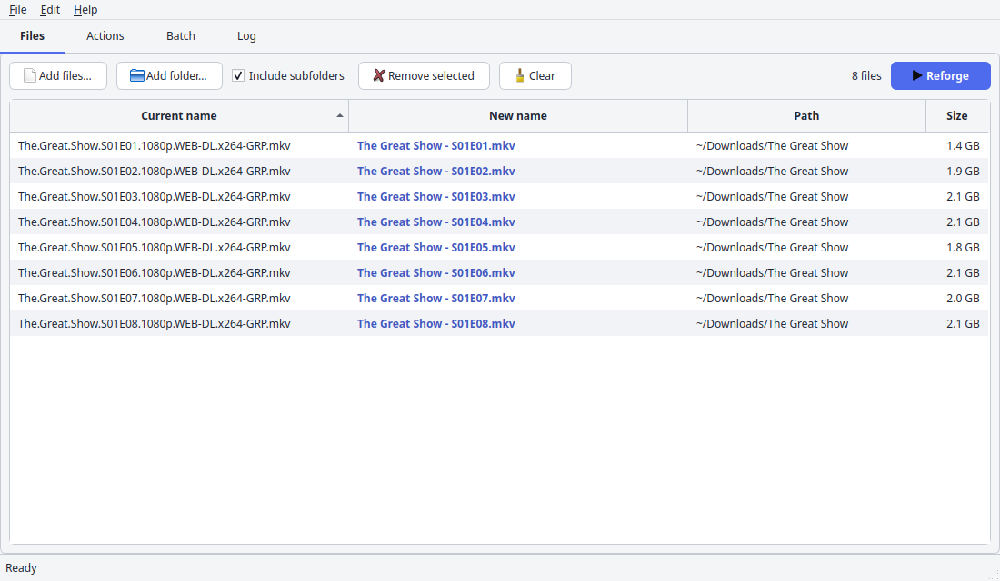

<div align="center">

# NameReforge

**Batch-rename files with a live preview and a safety net.**<br>
A modern, cross-platform take on Ant Renamer.

[](https://github.com/klode82/NameReforge/actions/workflows/ci.yml)


[](LICENSE)

[](https://www.python.org/)
[](https://doc.qt.io/qtforpython-6/)
[](https://mutagen.readthedocs.io/)
[](https://python-pillow.org/)
[](https://pyinstaller.org/)
[](https://pytest.org/)
[](https://docs.astral.sh/ruff/)
[](.github/workflows)

<picture>
  <source media="(prefers-color-scheme: dark)" srcset="docs/screenshots/en-files-dark.png">
  
</picture>

</div>

## Features

- **Live preview.** Every change shows up in the *New name* column while you type. **Nothing is written to disk until you press Reforge.**
- **13 actions**, from simple text replacement to regular expressions, audio tags and photo EXIF data (see [Actions](#actions)).
- **Batch & profiles.** Stack actions, reorder them by drag & drop, switch them on and off, save the sequence as a JSON profile.
- **Safe by design.** Existing files are never overwritten; collisions and invalid names turn the row red and block the rename; swaps, chains and case-only renames are handled.
- **Undo that survives a restart.** `Ctrl+Z` restores the original names, even after closing the program.
- **Fast with big lists.** The table is virtual and the preview is computed off the UI thread (tested with 50,000 files).
- **Light and dark themes** that follow your system, plus **English and Italian** with a built-in contextual help (`F1`).
- **Cross-platform.** One codebase for Linux, Windows and macOS.

## Quick start

Requires **Python 3.12 or newer**.

```bash
git clone https://github.com/klode82/NameReforge.git
cd NameReforge
python -m venv .venv
.venv/bin/pip install -e ".[dev]"        # Windows: .venv\Scripts\pip
.venv/bin/python -m nameforge            # Windows: .venv\Scripts\python
```

## How to use

1. **Files**: drag files or folders into the window, or use *Add files* / *Add folder*.
2. **Actions**: pick an action and fill in its fields. The *Preview* table under the fields shows the result right away.
3. **Batch** *(optional)*: press *Add to batch* to chain several actions; each one works on the result of the previous one.
4. **Reforge** (`Ctrl+Enter`): applies the new names to the disk. Check the **Log** tab for the outcome of every file.

Colors in the table: **bold colored** = will be renamed, normal = unchanged, **red** = conflict (hover the row to read why). The Reforge button stays off while a conflict exists.

Press **`F1`** for the guide of the current tab, or hover any field for a tooltip. Every field has one.

## Actions

| Action | What it does |
| --- | --- |
| Replace text | Replaces a literal piece of text in the name |
| Change extension | Replaces, adds, removes or changes the case of the extension |
| Upper/lower case | lowercase, UPPERCASE, Title Case, Sentence case |
| Numbering | Progressive counters with padding, step, and restart per folder |
| Insert / Move / Delete characters | Edits by character position, counted from the start or from the end |
| Random name | Stable random names (same seed, same names) |
| Regular expression | Python `re` with capture groups; the replacement accepts `\1` and `$1` |
| Date and time | Inserts the modified, created or accessed date with a custom format |
| Audio tags | Builds the name from tags: `{artist} - {title}` (MP3, FLAC, OGG, Opus, M4A) |
| EXIF metadata | Builds the name from photo data: `{date:%Y-%m-%d_%H%M%S}`, camera, size |
| Names from file | Takes the new names, one per line, from a `.txt` or `.csv` file |

## Built with

| | Used for |
| --- | --- |
| **Python 3.12+** | Everything, including the rename engine, which has no GUI dependency |
| **PySide6 (Qt 6)**, Fusion style | The interface: model/view tables, threads, themes |
| **mutagen** | Reading audio tags (ID3, Vorbis comments, MP4 atoms) |
| **Pillow** | Reading EXIF data and image sizes |
| **PyInstaller** | Self-contained builds (no Python needed on the target machine) |
| **pytest + pytest-qt**, **Ruff** | Tests (including GUI tests, run headless) and linting |
| **GitHub Actions** | CI on Linux, Windows and macOS, and the release pipeline |

## Languages

The interface follows your system language (Italian or English) and can be changed from **Help → Language**; the change applies at the next start.

Translations are plain JSON files, no tooling needed:

- `src/nameforge/assets/i18n/<lang>.json` holds the interface texts (the key is the Italian source text, the value is the translation).
- `src/nameforge/assets/help.<lang>.json` holds the tooltips and the guides.

To add a language, register it in `src/nameforge/i18n.py`, run `python tools/i18n_extract.py --write` to create the missing entries, translate them, and copy `help.en.json` to `help.<lang>.json`. The tests tell you what is still missing.

## Development

```bash
.venv/bin/pytest -q          # GUI tests run headless (the CI sets QT_QPA_PLATFORM=offscreen)
.venv/bin/ruff check .
QT_QPA_PLATFORM=offscreen .venv/bin/python tools/bench_files.py     # performance with 50,000 files
.venv/bin/python tools/i18n_extract.py                              # translations still missing or orphaned
```

```
src/nameforge/
├── core/          rename engine without Qt: actions, plan, executor, metadata, scan
├── assets/        icons, help texts (help*.json), translations (i18n/)
└── *.py           the Qt interface: main window, tabs, models, theme, help, i18n
packaging/         PyInstaller spec, Windows installer script, Linux packages
tools/             icon generator, benchmark, translation extractor
tests/             engine, GUI, translations and help tests
docs/screenshots/  images used in this README
```

## Packaging

```bash
pip install -e ".[build]"
cd packaging && pyinstaller nameforge.spec --noconfirm --distpath ../dist --workpath ../build
dist/NameReforge/NameReforge --selftest        # checks that the build is complete
```

`.github/workflows/release.yml` builds on every `v*` tag: a `.tar.gz`, `.deb`, `.rpm` and `.AppImage` on Linux, an installer on Windows (Inno Setup) and a `.dmg` on macOS, and attaches them to a GitHub release.

> [!NOTE]
> The release pipeline is new and has not run on a real tag yet. The Linux packages were tested in clean containers; the Windows installer and the macOS `.dmg` have not been tried. Binaries must be built on an older system (the pipeline uses Ubuntu 22.04) to run on older distributions.

## Status

Under active development. Tests pass on Linux, Windows and macOS in CI. Official Debian packaging (built from source) is a possible future step.

## License

Released under the [MIT License](LICENSE).

## Acknowledgements

Inspired by [Ant Renamer](https://www.antp.be/software/renamer) by Antoine Potten. NameReforge is an independent project and shares no code with it.
